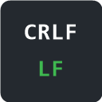

# GitHub Line Endings

A Chrome extension that shows whether code on GitHub uses **LF** or **CRLF** line endings.
GitHub renders both the same way, so you normally can't tell.



## What it shows

A small box in the bottom-right corner of the page:

| Page | Box |
|---|---|
| File (`/owner/repo/blob/...`) | `Line endings: LF`, `CRLF`, `Mixed (3 CRLF, 40 LF)` or `no line breaks` |
| Pull request (`/owner/repo/pull/N`, any tab) | A summary such as `Line endings in diff: 3 CRLF, 280 LF`, then one line per changed file |

Click the PR box header to minimize it to the summary line. It stays minimized while you browse in that tab.

Binary files (images, PDFs, Office documents, ...) are skipped.

## Install (development)

1. Clone this repo.
2. Open `chrome://extensions` and turn on **Developer mode**.
3. Click **Load unpacked** and pick the repo folder.
4. Open a file or pull request on github.com.

Works in Chrome and Edge. Private repos use your existing GitHub login.

## How it works

- `content.js` runs on github.com pages. It watches the URL (GitHub changes pages without reloading) and draws the box.
- `welcome.html` opens once, right after the extension is installed.
- `background.js` downloads the data, because the PR `.diff` redirects to `patch-diff.githubusercontent.com`, which page scripts may not read.
  - File page: the raw file, `/owner/repo/raw/<ref>/<path>`.
  - PR page: the whole PR diff, `/owner/repo/pull/N.diff`, once. It is reused for 60 seconds while you switch PR tabs.
- A line counts as CRLF when it ends in `\r\n`. A file is binary when its first 8000 bytes contain a zero byte (the same test Git uses).

## Limits

- Works on github.com only, not GitHub Enterprise servers.
- Very large PRs may show an error if GitHub refuses or times out on the diff.
- On PRs, only the lines shown in the diff are checked, not whole files.
- Files using old Mac line endings (lone `\r`) show `no line breaks`.
- UTF-16 text files count as binary and are skipped.
- Git LFS files may fail to load.
- New commits on a PR show up after at most 60 seconds, or on reload.

## Test

Open `test.html` in a browser. It prints `PASS` or the failing check.

## Package for the Chrome Web Store

```powershell
Compress-Archive -Force -Path manifest.json,background.js,content.js,icon128.png,welcome.html -DestinationPath line-endings.zip
```

Upload `line-endings.zip` in the Chrome Web Store Developer Dashboard. Raise `version` in `manifest.json` for each new upload.

## Privacy

The extension collects nothing. It only requests data from GitHub, using your own browser session, and keeps results in memory.
